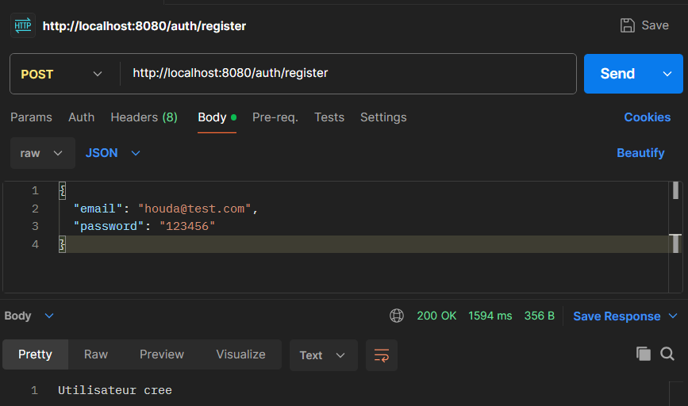
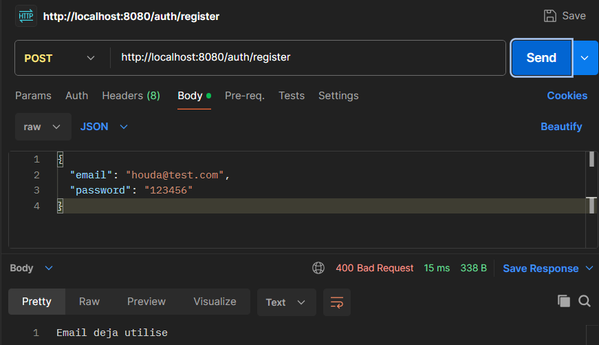
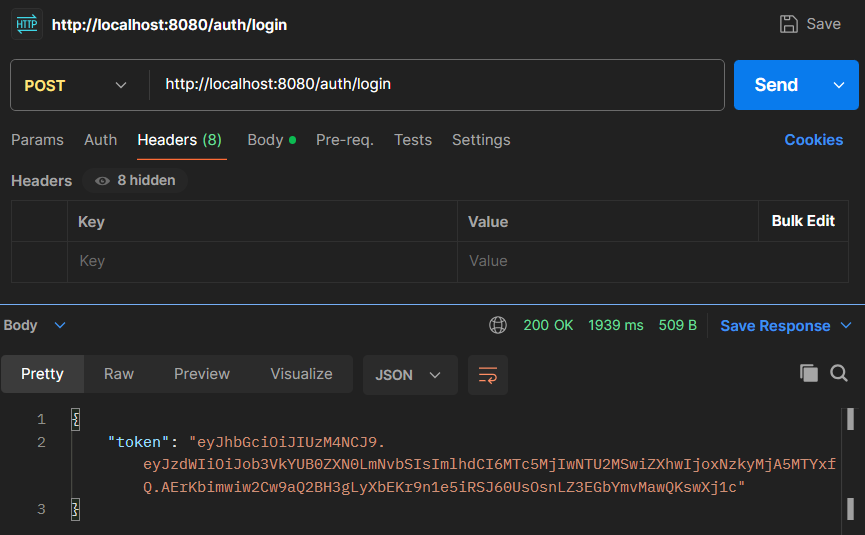
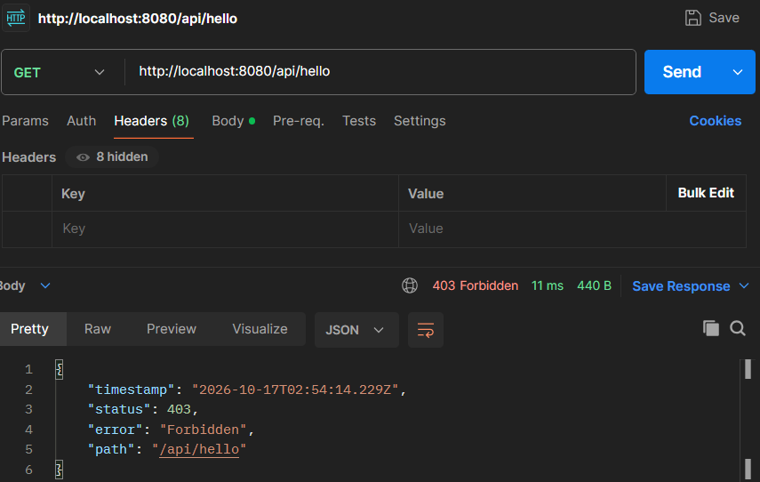
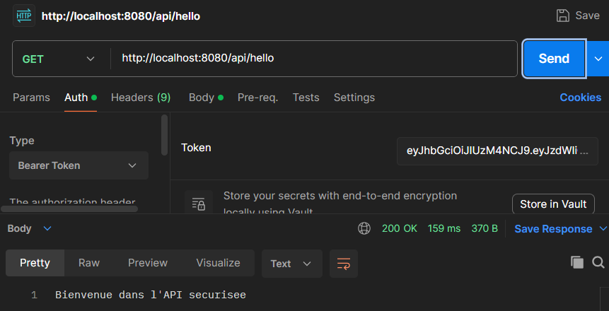
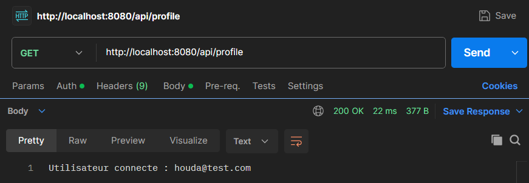
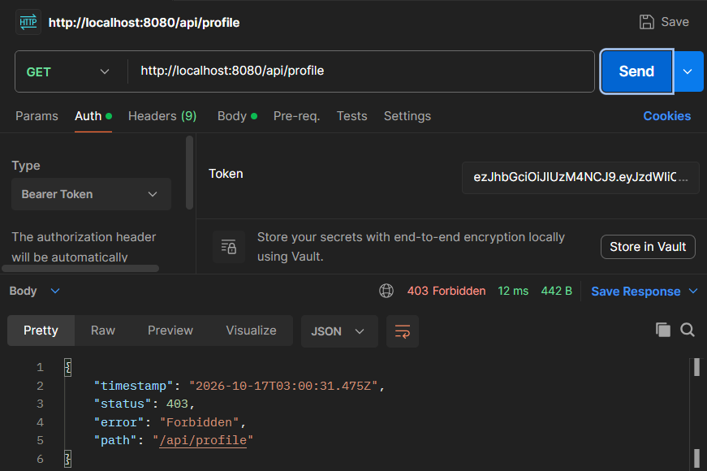
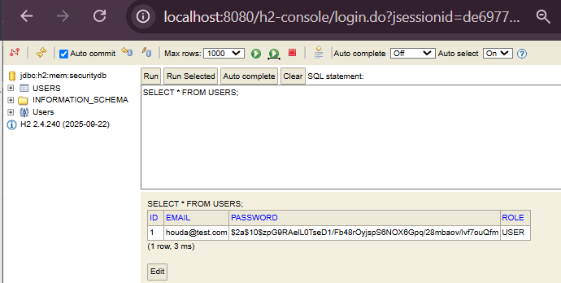

# TP : Authentification JWT avec Spring Boot

## Objectif

Mettre en place une authentification *stateless* : l'utilisateur s'inscrit, se connecte, reçoit un token JWT, puis l'utilise pour accéder aux endpoints protégés.

## Technologies

- Java 17, Spring Boot 4
- Spring Security
- Spring Data JPA + base H2 (en mémoire)
- JJWT 0.13.0
- Postman (tests)

## Structure du projet

```
ma.enset.tpjwtspring
├── config        → SecurityConfig
├── controllers   → AuthController, UserController
├── dto           → AuthResponse, LoginRequest, RegisterRequest
├── entity        → AppUser
├── repository    → UserRepository
├── security      → JwtFilter
├── service       → CustomUserDetailsService, JwtService
└── TpJwtSpringApplication
```

## Lancer le projet

```bash
./mvnw spring-boot:run
```

L'application démarre sur `http://localhost:8080`.

## Endpoints

| Méthode | URL              | Accès   | Description                    |
|---------|------------------|---------|--------------------------------|
| POST    | `/auth/register` | Public  | Créer un utilisateur           |
| POST    | `/auth/login`    | Public  | Obtenir un token JWT           |
| GET     | `/api/hello`     | Protégé | Message de bienvenue           |
| GET     | `/api/profile`   | Protégé | Affiche l'utilisateur connecté |

## Tests avec Postman

### 1. Inscription

`POST /auth/register`



### 2. Inscription avec un email déjà utilisé

L'API refuse le doublon (400).



### 3. Connexion et récupération du token

`POST /auth/login`



### 4. Accès à un endpoint protégé sans token

`GET /api/hello` sans en-tête `Authorization` : accès refusé.



### 5. Accès avec un token valide

`GET /api/hello` avec `Authorization: Bearer <token>`.



### 6. Profil de l'utilisateur connecté

`GET /api/profile`



### 7. Token invalide

Un token modifié est rejeté.



### 8. Base H2 : mot de passe haché (BCrypt)

Console H2 : `http://localhost:8080/h2-console` (JDBC URL : `jdbc:h2:mem:securitydb`).



## Fonctionnement

1. `POST /auth/login` : `AuthenticationManager` vérifie l'email et le mot de passe grâce à `CustomUserDetailsService` et BCrypt.
2. `JwtService` génère un token signé (HMAC) contenant le `subject` (email) et une date d'expiration (1 h).
3. À chaque requête, `JwtFilter` lit l'en-tête `Authorization: Bearer <token>`, valide le token et place l'utilisateur dans le `SecurityContext`.
4. `SecurityConfig` : `/auth/**` est public, `/api/**` exige une authentification, les sessions sont `STATELESS` et le CSRF est désactivé.
